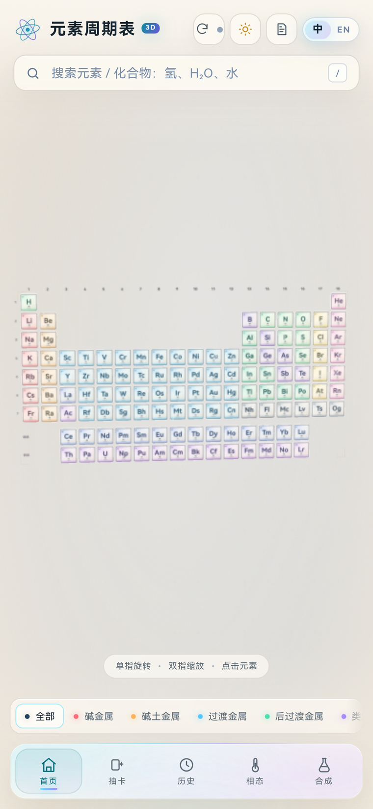

# 元素周期表 3D · Periodic Table 3D

**中文** | [English](README_EN.md)

一个单文件的 3D 元素周期表：Three.js 实时渲染，支持旋转 / 缩放 / 点选元素、相态模拟、抽卡、元素发现史时间轴、化合物搜索与合成。

无需构建、无需联网，双击 `index.html` 即可运行。



## 特性

- **3D 周期表**：118 个元素卡片，悬停浮起、选中放大、双面贴图（从背面看文字依然正向）
- **元素详情**：分类、周期族、相对原子质量、电子排布壳层动画、元素影像、发现简史
- **搜索**：元素与化合物统一搜索，按相关度排序，支持中文名 / 英文名 / 化学式 / 原子序数，键盘 ↑↓ + Enter 可用
- **相态模拟**：温度滑杆 -273 ℃ ~ 沸点以上，按固 / 液 / 气 / 未知着色，支持自动升温
- **抽卡 / 图鉴**：随机获取元素卡，记录收集进度
- **元素发现史**：按年代播放的时间轴，配元素卡片聚焦动画
- **合成**：选择元素组合，匹配化合物库
- **中 / 英双语**，浅色 / 深色 / 跟随系统主题

## 移动端适配

面向手机做了针对性处理，而不是简单缩小：

- 取景按**实测的顶栏 / 图例 / 底栏占位**计算，竖屏、小屏、横屏都不会被 UI 遮挡裁切
- 3D 俯视下「几何中心」与「视觉中心」不重合，按投影实测校正
- 触屏点选增加**最近瓦片兜底**（手指落点偏一格也能选中）
- 横屏下元素详情改为右侧紧凑侧栏；竖屏用底部抽屉
- WebGL 上下文丢失自动恢复，恢复失败则重载一次
- 画布像素比按设备能力降档，画面静止 1.6 s 后降帧、切后台停渲
- `dvh` + 安全区适配，避免 iOS 地址栏收起裁掉底栏

## 首屏无闪屏

首页启动时不再出现「遮罩淡出 / 卡片贴图重画 / 缓冲重建」三件事撞在一起：

- 字体就绪后**一次性**重建 118 张卡片贴图（此时整屏被加载遮罩覆盖，开销不可见），预热两帧后才淡出
- resize 做尺寸 / 像素比去重，尺寸没变就不重建绘制缓冲
- 画布与浮动 UI 等场景预热完成后整体淡入

## 低角度闪烁

压低视角接近水平时，卡片正面贴图与卡体正面本只差 0.008 世界单位，在旧的深度分布下会周期性打架：

- `near / far` 由 `0.1 / 260` 收紧到 `0.35 / 190`，有效深度精度提升约 3.5 倍
- 贴图与相态覆盖层加 `polygonOffset`，斜得越狠沿深度斜率推开越多
- 层面间距由 0.008 放大到 0.022

## 快速开始

```bash
git clone <this-repo>
cd periodic-table-3d
# 直接打开
open index.html          # macOS
xdg-open index.html      # Linux
# 或起一个本地静态服务（可选）
python3 -m http.server 8080
```

浏览器要求：支持 WebGL 2 的现代浏览器（Chrome / Edge / Safari 15+ / Firefox）。

## 部署

纯静态单文件，任意静态托管都行：

- **GitHub Pages**：Settings → Pages → Source 选 `Deploy from a branch`，分支 `main`，目录 `/ (root)`
- Vercel / Netlify / Cloudflare Pages：直接拖仓库，无需构建命令

## 结构

```
.
├── index.html          # 全部代码与资源（Three.js bundle + 字体 + 元素影像精灵图，内联）
├── docs/preview.png    # README 预览图
├── LICENSE             # MIT
└── THIRD-PARTY-NOTICES.md
```

单文件是刻意设计：便于离线分发、便于当附件发出去，不需要打包工具链。

## 数据与致谢

- 元素基础数据（符号、名称、原子量、电子排布、发现年代等）整理自公开资料
- 元素影像来自 [images-of-elements.com](https://images-of-elements.com/)（每张图在详情面板内保留来源链接）
- 3D 渲染基于 [Three.js](https://threejs.org/)（MIT）
- 字体内嵌 HarmonyOS Sans，版权归华为所有，详见 `THIRD-PARTY-NOTICES.md`

## 许可

代码以 MIT 许可发布，详见 `LICENSE`。

© 2026 小空

**注意**：仓库内内联的第三方素材（元素影像、字体）不适用 MIT，商业使用前请阅读 `THIRD-PARTY-NOTICES.md` 并自行确认授权。
