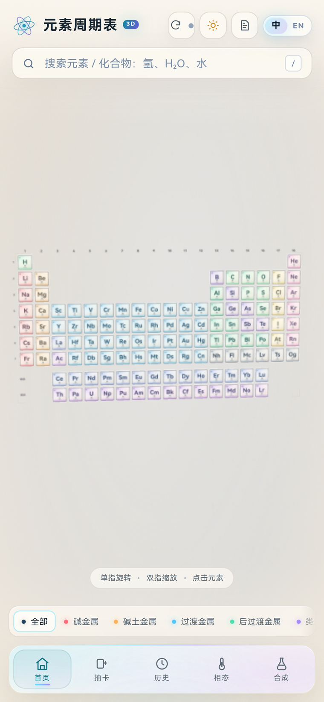

# Periodic Table 3D

A single-file 3D periodic table. Three.js renders 118 element cards in real time — rotate, zoom, tap to open an element, simulate phase states, collect cards, replay the history of discovery, and search compounds.

No build step, no network: open `index.html` and it runs.

[中文说明](README.md) | **English**



## Features

- **3D periodic table** — 118 element cards, cards lift on hover, scale up when selected, and carry double-sided labels (text stays upright when viewed from behind)
- **Element detail** — category, period/group, relative atomic mass, animated electron shells, specimen image, discovery notes
- **Search** — one box for elements and compounds, relevance ranked, accepting Chinese names, English names, formulas and atomic numbers, full keyboard support (`↑` `↓` + `Enter`)
- **Phase simulation** — temperature slider from -273 °C upward, colour coded solid / liquid / gas / unknown, with an auto-heat mode
- **Gacha & collection** — pull element cards at random and track your collection
- **Timeline** — replay element discovery by year, with the camera focusing each card
- **Synthesis** — pick elements and match them against a compound library
- **Bilingual (zh / en)** UI, light / dark / follow-system themes

## Mobile specifics

Not just a shrunken desktop layout:

- The camera framing is computed from the **measured footprint of the top bar, legend and dock**, so portrait, small screens and landscape never crop or hide the table behind UI
- The optical centre is corrected by projecting the table bounds, because the geometric centre of a 3D table seen from above is not where the eye expects it
- Tapping falls back to the **nearest tile**, so an off-by-one-hundred-pixels finger still selects the intended element
- In landscape the element detail becomes a compact right-hand sidebar; portrait uses a bottom sheet
- WebGL context loss is handled and recovered; if recovery fails the page reloads once
- Pixel ratio scales down on weak GPUs, rendering drops to ~30 fps when the scene is idle and pauses in background tabs
- `dvh` plus safe-area insets, so collapsing browser chrome no longer clips the dock

## No flash on first paint

Previously three things collided in the first second: the loading veil fading out, all 118 card textures being rebuilt frame by frame after fonts loaded, and drawing buffers being reallocated by redundant resizes.

Now: labels are rebuilt **once**, synchronously, while the veil still covers the screen; two frames are rendered to warm the GPU; only then does the veil fade. Resizes are de-duplicated by size and pixel ratio, and the canvas plus floating UI fade in as a single unit.

## Grazing-angle flicker

Tilt the camera close to horizontal and the card label previously sat only 0.008 world units in front of the card body — with the old depth distribution that produced depth fights and visible shimmer.

- `near / far` tightened from `0.1 / 260` to `0.35 / 190`, improving effective depth precision by roughly 3.5×
- Labels and the phase overlay use `polygonOffset`, pushing them toward the camera proportionally to the depth slope
- Layer separation widened from 0.008 to 0.022

## Quick start

```bash
git clone https://github.com/renhaoning8-art/periodic-table-3d.git
cd periodic-table-3d
open index.html        # macOS
xdg-open index.html    # Linux
# optional local server
python3 -m http.server 8080
```

Requires a WebGL 2 capable browser (Chrome / Edge / Safari 15+ / Firefox).

## Deploy

A pure static single file — any static host works:

- **GitHub Pages**: already enabled for this repo (live at https://renhaoning8-art.github.io/periodic-table-3d/)
- Vercel / Netlify / Cloudflare Pages: drop the repo in, no build command needed

## Layout

```
.
├── index.html                 # code and assets in one file (Three.js bundle, font, specimen sprite)
├── docs/preview.png
├── .github/verify.py          # CI structural check
├── .github/workflows/ci.yml
├── LICENSE
└── THIRD-PARTY-NOTICES.md
```

The single file is deliberate: easy to hand over as an attachment, easy to run offline, no toolchain.

## Data & credits

- Element data (symbols, names, masses, electron configuration, discovery year) compiled from public sources
- Specimen images from [images-of-elements.com](https://images-of-elements.com/) — the source page for each image stays linked inside the detail panel
- Rendering built on [Three.js](https://threejs.org/) (MIT)
- The embedded HarmonyOS Sans font is property of Huawei — see `THIRD-PARTY-NOTICES.md`

## License

Source code is MIT licensed (see `LICENSE`). **Third-party assets embedded in `index.html` — specimen images and the font — are not covered by MIT.** Read `THIRD-PARTY-NOTICES.md` before commercial use.
